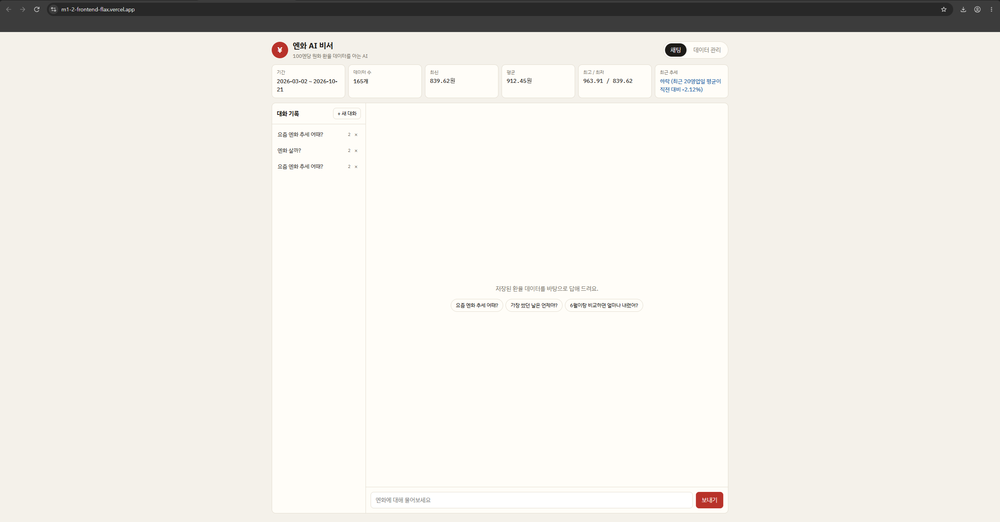
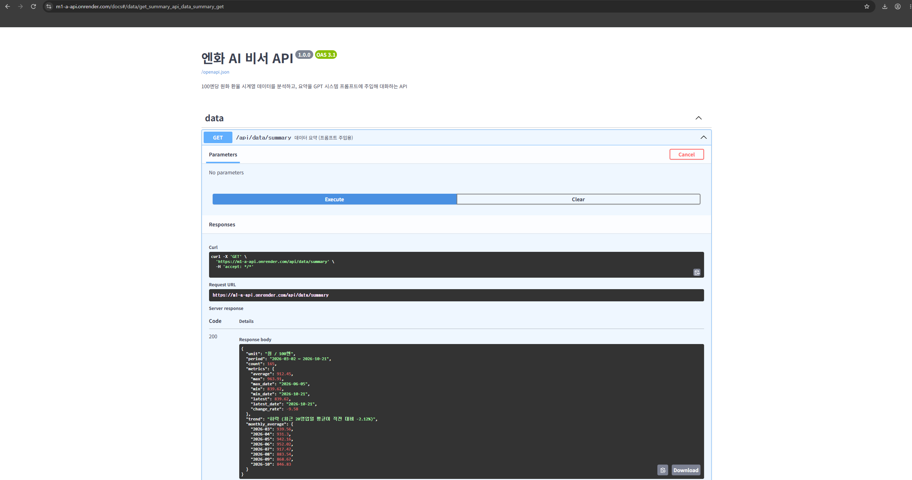
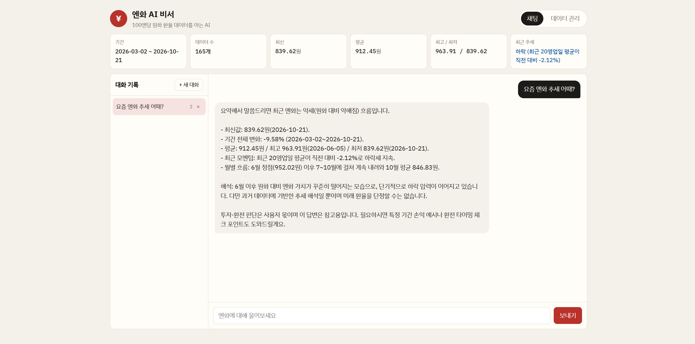
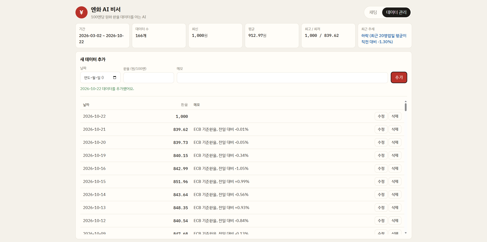
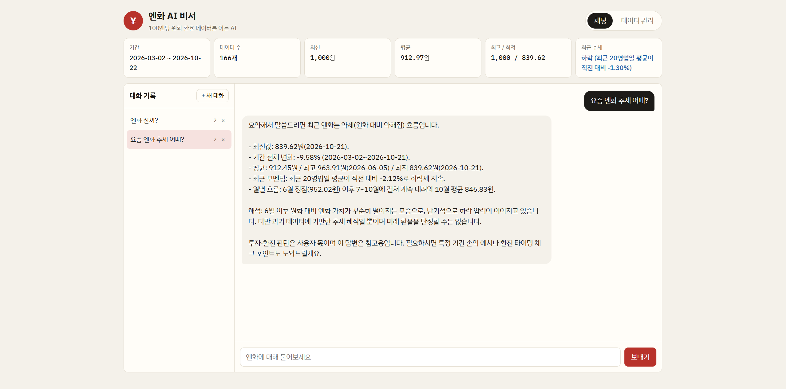

# 엔화 AI 비서 (Yen AI Assistant)

> 내 엔화 환율 데이터를 알고 대답하는 AI 비서

일반 ChatGPT는 "요즘 엔화 어때?"라고 물어도 내가 보고 있는 데이터를 모릅니다.
이 서비스는 **100엔당 원화 환율 시계열 데이터**를 Firestore에 저장·분석하고,
그 **요약(기간·평균·최고/최저·추세·월평균)을 GPT 시스템 프롬프트에 주입**해서
"가장 쌌던 날은?", "6월보다 얼마나 내렸어?" 같은 질문에 실제 숫자로 답합니다.

## 배포 URL

| 구분 | URL |
|---|---|
| 프론트엔드 (Vercel) | https://m1-2-frontend-flax.vercel.app |
| 백엔드 API (Render) | https://m1-a-api.onrender.com |
| Swagger UI | https://YOUR-API.onrender.com/docs |

> Render 무료 티어는 15분간 요청이 없으면 잠듭니다. 첫 접속 시 최대 1분 정도 걸릴 수 있으며,
> 프론트는 시작할 때 `/health`로 서버를 먼저 깨우고, 응답이 3초 넘게 걸리면 상단에 안내 배너를 띄웁니다.

## 기술 스택

- **Backend**: Python 3.11, FastAPI, Uvicorn, Pydantic v2
- **DB**: Firebase Firestore (`firebase-admin`)
- **AI**: OpenAI Chat Completions (코디세이 OpenAI 호환 게이트웨이, `gpt-5-mini`, `max_completion_tokens=2000`)
- **Frontend**: HTML / CSS / JavaScript (프레임워크 없음)
- **Deploy**: Render (백엔드), Vercel (프론트엔드)

## 데이터

- 출처: 유럽중앙은행(ECB) 기준환율 (Frankfurter API) JPY→KRW, ×100 하여 **원/100엔** 단위로 변환
- 기간: 2026-03-02 ~ 2026-10-21, **165개** 영업일 데이터 (`backend/data/jpy_krw.csv`)
- 형식: `(date, value, memo)` — memo에는 전일 대비 변동률

### 분석(요약) 방식 — `GET /api/data/summary`

| 항목 | 계산 |
|---|---|
| period / count | 첫 날짜 ~ 마지막 날짜, 레코드 수 |
| metrics | 평균, 최고(날짜), 최저(날짜), 최신값, 기간 전체 변화율 |
| trend | 최근 20영업일 평균 vs 직전 20영업일 평균 비교 → ±0.5% 초과면 상승/하락, 아니면 보합 |
| monthly_average | 월별 평균 (AI가 "몇 월이 가장 비쌌어?"에 답할 수 있도록) |

```json
{
  "unit": "원 / 100엔",
  "period": "2026-03-02 ~ 2026-10-21",
  "count": 165,
  "metrics": {
    "average": 912.45, "max": 963.91, "max_date": "2026-06-05",
    "min": 839.62, "min_date": "2026-10-21",
    "latest": 839.62, "latest_date": "2026-10-21", "change_rate": -9.58
  },
  "trend": "하락 (최근 20영업일 평균이 직전 대비 -2.12%)",
  "monthly_average": { "2026-03": 939.56, "2026-06": 952.02, "2026-10": 846.83 }
}
```

## 프로젝트 구조

```
yen-ai-assistant/
├── backend/
│   ├── main.py                  # FastAPI 앱, CORS, 라우터 등록
│   ├── requirements.txt
│   ├── .env.example
│   ├── data/jpy_krw.csv         # 시계열 원본 데이터 165개
│   ├── scripts/seed_data.py     # CSV → Firestore 업로드
│   └── app/
│       ├── config.py            # 환경 변수 로딩
│       ├── firebase.py          # Firestore 클라이언트
│       ├── schemas.py           # Pydantic 요청/응답 모델
│       ├── routers/             # HTTP 계층: 경로, 상태코드, 에러 변환
│       │   ├── data.py
│       │   ├── conversations.py
│       │   └── chat.py
│       └── services/            # 비즈니스 로직: DB 접근, 분석, GPT 호출
│           ├── data_service.py
│           ├── conversation_service.py
│           └── chat_service.py
└── frontend/
    ├── build.js                 # API_BASE_URL 환경변수 → public/config.js
    ├── vercel.json
    └── public/ (index.html, style.css, app.js)
```

**분리 기준**: router는 "요청을 받고 응답 코드를 정하는 일"만, service는 "Firestore/OpenAI와 일하는 로직"만 담당합니다.
그래서 `/api/chat`은 라우터에서 404/502 변환만 하고, 요약 → 프롬프트 → GPT → 저장 흐름은 `chat_service.chat()`에 있습니다.

**Pydantic 검증**: `value`는 0 초과 10000 미만, `date`는 실제 날짜 형식, `memo` 200자, 채팅 메시지 1~1000자로 제한.
잘못된 요청은 DB/GPT까지 가지 않고 FastAPI가 자동으로 422를 돌려줍니다.

## Firestore 컬렉션

| 컬렉션 | 문서 필드 |
|---|---|
| `data` | `date` (YYYY-MM-DD 문자열), `value` (number), `memo` (string) |
| `conversations` | `title`, `messages` [{`role`, `content`}], `created_at`, `updated_at` |

## API

| Method | Path | 설명 |
|---|---|---|
| POST | `/api/data` | 새 데이터 추가 |
| GET | `/api/data` | 데이터 목록 (날짜순) |
| PUT | `/api/data/{id}` | 데이터 수정 (보낸 필드만 변경) |
| DELETE | `/api/data/{id}` | 데이터 삭제 |
| GET | `/api/data/summary` | 데이터 요약 (프롬프트 주입용) |
| POST | `/api/conversations` | 대화 저장 |
| GET | `/api/conversations` | 대화 목록 — **messages 미포함**(id, title, message_count, 시간) |
| GET | `/api/conversations/{id}` | 특정 대화 전체 messages 조회 (방식 A) |
| DELETE | `/api/conversations/{id}` | 대화 삭제 |
| POST | `/api/chat` | AI 채팅 `{message, conversation_id?}` → `{reply, conversation_id, summary}` |
| GET | `/health` | 헬스 체크 (콜드스타트 깨우기) |

### 컨텍스트 주입 흐름 (`POST /api/chat`)

1. `data_service.get_summary()`로 데이터 요약 생성
2. 요약을 시스템 프롬프트의 `[사용자 데이터 요약]` 블록에 삽입
3. (이어지는 대화면) 기존 대화의 최근 10개 메시지를 함께 전달
4. GPT 호출 (`max_completion_tokens=2000`)
5. 질문/답변을 `conversations`에 자동 저장 (새 대화면 첫 질문으로 제목 생성)

GPT는 실시간 데이터를 모르지만, 매 요청마다 최신 요약을 시스템 프롬프트로 받기 때문에
데이터를 추가/수정하면 다음 답변부터 바로 반영됩니다.

## 로컬 실행

### 1) 백엔드

```bash
cd backend
python -m venv venv
venv\Scripts\activate          # Windows  (mac/Linux: source venv/bin/activate)
pip install -r requirements.txt
copy .env.example .env         # mac/Linux: cp .env.example .env  → 값 채우기

python -m scripts.seed_data    # CSV 165개를 Firestore에 업로드 (최초 1회)
uvicorn main:app --reload      # http://127.0.0.1:8000/docs
```

### 2) 프론트엔드

```bash
cd frontend
node build.js                  # API_BASE_URL 미설정 시 http://127.0.0.1:8000 사용
cd public
python -m http.server 5500     # http://localhost:5500
```

## 환경 변수

| 이름 | 위치 | 설명 |
|---|---|---|
| `OPENAI_API_KEY` | 백엔드 | OpenAI API 키 (코디세이 발급 키) |
| `OPENAI_BASE_URL` | 백엔드 | OpenAI 호환 API 주소 (`https://copa.codyssey.kr/v1`) |
| `FIREBASE_SERVICE_ACCOUNT_JSON` | 백엔드(Render) | 서비스 계정 키 JSON 전체를 한 줄 문자열로 |
| `FIREBASE_SERVICE_ACCOUNT_PATH` | 백엔드(로컬) | 서비스 계정 키 파일 경로 (JSON 대신 사용) |
| `ALLOWED_ORIGINS` | 백엔드 | CORS 허용 도메인, 쉼표 구분 (예: `https://m1-2-frontend-flax.vercel.app`) |
| `OPENAI_MODEL` | 백엔드 | `gpt-5-mini` |
| `OPENAI_MAX_TOKENS` | 백엔드 | `2000` (gpt-5 계열은 추론 토큰도 쓰므로 넉넉히) |
| `API_BASE_URL` | 프론트(Vercel) | 백엔드 주소 (예: `https://your-api.onrender.com`) |

키 파일과 `.env`는 `.gitignore`에 등록되어 커밋되지 않습니다.

## 배포

**Render (백엔드)** — New → Web Service → 저장소 연결
- Root Directory: `backend`
- Build: `pip install -r requirements.txt`
- Start: `uvicorn main:app --host 0.0.0.0 --port $PORT`
- Environment에 `OPENAI_API_KEY`, `OPENAI_BASE_URL`, `OPENAI_MODEL`, `OPENAI_MAX_TOKENS`, `FIREBASE_SERVICE_ACCOUNT_JSON`, `ALLOWED_ORIGINS`, `PYTHON_VERSION=3.11.9` 추가

**Vercel (프론트엔드)** — New Project → 같은 저장소
- Root Directory: `frontend` (빌드/출력 설정은 `vercel.json`이 지정)
- Environment Variables에 `API_BASE_URL` 추가 → 배포
- 배포된 Vercel 주소를 Render의 `ALLOWED_ORIGINS`에 추가

## 배포 확인 (런타임 증거)

배포된 URL에 실제로 요청한 결과입니다 (2026-10-22 측정). 전체 로그: [docs/deploy-check.txt](docs/deploy-check.txt)

| 확인 대상 | 요청 | 결과 |
|---|---|---|
| 백엔드 헬스 체크 | `GET https://m1-a-api.onrender.com/health` | `200 OK`, `{"status":"ok"}` |
| Swagger UI | `GET https://m1-a-api.onrender.com/docs` | `200 OK`, `<title>엔화 AI 비서 API - Swagger UI</title>` |
| 데이터 요약 API | `GET https://m1-a-api.onrender.com/api/data/summary` | `200 OK`, `"count":165`, `"trend":"하락 (최근 20영업일 평균이 직전 대비 -2.12%)"` |
| 프론트엔드 | `GET https://m1-2-frontend-flax.vercel.app/` | `200 OK` (Server: Vercel), `<title>엔화 AI 비서</title>` |

### 배포된 프론트엔드 접속 화면
배포된 Vercel 주소에서 요약 카드(165개)와 대화 기록이 Render 백엔드로부터 불러와진 화면입니다.



### 배포된 Swagger UI (/docs) 접속 화면
배포된 Render 주소의 `/docs`에서 `GET /api/data/summary`를 실행해 200 응답을 받은 화면입니다.



## 스크린샷

### 데이터 요약이 보이는 채팅 화면


### 데이터 관리 (추가 동작)


### 대화 기록 불러오기

